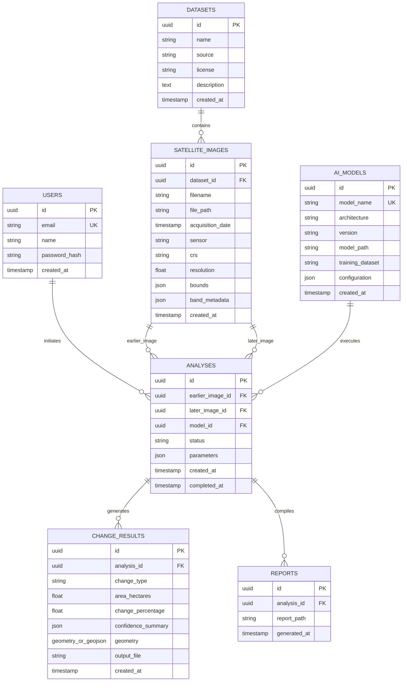

# GeoIntelligence AI — Database Schema Specification

## 1. Relational & Spatial Schema Overview
GeoIntelligence AI utilizes PostgreSQL 18 with the PostGIS extension for enterprise-scale spatial indexing and vector topology storage. It features an automated, zero-configuration SQLite fallback storing RFC 7946 GeoJSON representations with Python Shapely spatial validation for local execution.

---

## 2. Entity-Relationship Model

---

## 3. Data Dictionary

### 3.1 `datasets`
- `id`: UUID Primary Key
- `name`: VARCHAR(255), Not Null
- `source`: VARCHAR(255) (e.g., "Copernicus Open Access Hub", "USGS EarthExplorer", "OSCD")
- `license`: VARCHAR(100) (e.g., "CC-BY 4.0", "Open Access")
- `description`: TEXT

### 3.2 `satellite_images`
- `id`: UUID Primary Key
- `dataset_id`: UUID Foreign Key -> `datasets.id`
- `filename`: VARCHAR(255), Not Null
- `file_path`: VARCHAR(512), Path to raster GeoTIFF on disk
- `acquisition_date`: TIMESTAMP WITH TIME ZONE
- `sensor`: VARCHAR(50) (e.g., "Sentinel-2A MSI", "Landsat-8 OLI")
- `crs`: VARCHAR(100) (e.g., "EPSG:32632", "EPSG:4326")
- `resolution`: FLOAT (spatial resolution in meters, e.g., 10.0)
- `bounds`: JSONB (min_lat, min_lon, max_lat, max_lon)
- `band_metadata`: JSONB (list of bands present, wavelength, gain/offset)

### 3.3 `analyses`
- `id`: UUID Primary Key
- `earlier_image_id`: UUID FK -> `satellite_images.id`
- `later_image_id`: UUID FK -> `satellite_images.id`
- `model_id`: UUID FK -> `ai_models.id`
- `status`: VARCHAR(50) ("PENDING", "PROCESSING", "COMPLETED", "FAILED")
- `parameters`: JSONB (threshold, min_polygon_size_m2, classification_rules)
- `created_at`: TIMESTAMP
- `completed_at`: TIMESTAMP

### 3.4 `change_results`
- `id`: UUID Primary Key
- `analysis_id`: UUID FK -> `analyses.id`
- `change_type`: VARCHAR(100) ("Deforestation", "Flood", "Urban Expansion", "Agricultural Change", "Unclassified")
- `area_hectares`: FLOAT (Metric area in hectares, calculated in projected CRS)
- `change_percentage`: FLOAT (% of total valid geographical scene changed)
- `confidence_summary`: JSONB (mean_confidence, std_confidence, distribution)
- `geometry`: PostGIS GEOMETRY(MultiPolygon, 4326) or GeoJSON FeatureCollection text
- `output_file`: VARCHAR(512) (path to classified change raster or GeoJSON)

### 3.5 `reports`
- `id`: UUID Primary Key
- `analysis_id`: UUID FK -> `analyses.id`
- `report_path`: VARCHAR(512) (path to generated scientific PDF)
- `generated_at`: TIMESTAMP
