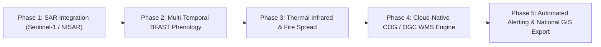

# GeoIntelligence AI: ISRO-Grade System Architecture & Improvement Roadmap

> **Target Benchmark**: National Remote Sensing Centre (NRSC) Bhuvan, Meteorological and Oceanographic Satellite Data Archival Centre (MOSDAC), Space Applications Centre (SAC) VEDAS, and NASA-ISRO Synthetic Aperture Radar (NISAR) Missions.

---

## 1. Executive Summary & Vision

GeoIntelligence AI currently delivers automated, research-grade multi-temporal change detection, land-cover classification, metric area quantification in equal-area projection (`EPSG:6933`), and integrated real-time atmospheric telemetry (temperature, wind vector, cloud optical attenuation, precipitation, and surface barometric pressure).

To advance this system to an **ISRO-Grade Earth Observation (EO) System**, the platform must transition from an episodic pairwise analysis tool to a continuous, multi-sensor, multi-spectral, microwave-penetrating planetary monitoring infrastructure capable of planetary-scale ingestion, autonomous disaster response, and climate-resilience modeling.

---

## 2. Comparative Benchmark: GeoIntelligence AI vs. ISRO Flagship Systems

| Capability | GeoIntelligence AI (Current) | ISRO Bhuvan / MOSDAC / VEDAS | Target ISRO-Grade Upgrade |
| :--- | :--- | :--- | :--- |
| **Sensors Supported** | Optical MSI (Sentinel-2, Landsat, OSCD) | Resourcesat-2A (LISS-IV, AWiFS), Cartosat-3, INSAT-3D/3DR, Oceansat-3, RISAT-1A / EOS-04 | Optical + C/S/L-Band SAR Fusion (NISAR, Sentinel-1) |
| **All-Weather Capability** | Optical-limited (Clouds block sensors; EO viability score flags degraded optical windows) | Optical + Dual-pol C-band & S-band SAR penetration through monsoon clouds | Automated SAR Microwave Backscatter Ratio ($\gamma^\circ_{VH}/\gamma^\circ_{VV}$) fallback |
| **Temporal Granularity** | Bi-temporal pairwise ($T_1 \to T_2$) | Daily geostationary (INSAT, 30-min intervals) + 5-day polar repeat | Dense multi-temporal harmonic trajectories (BFAST, LandTrendr) |
| **Atmospheric Correction** | Sen2Cor Level-2A BOA Surface Reflectance | 6S Radiative Transfer + Real-time Aerosol Optical Depth (AOD) from INSAT-3D | Deep Learning AOD Inversion & Haze Removal |
| **Change Classification** | 6 Land-Cover Categories via Spectral Thresholds + Siamese U-Net | National Land Use/Land Cover (LULC) Level-III (54 subclasses) | Hierarchical Geo-Ontology (LULC Level-III + Biome Phenology) |
| **Disaster Response** | Bounding box spatial analysis + Weather correlation | NDEM (National Database for Emergency Management) automated flood/cyclone/wildfire alerts | Autonomous Real-time Flood Inundation & Wildfire Spread Simulator |
| **Geospatial Standards** | REST API + GeoJSON + Raster GeoTIFF | OGC WMS, WMTS, WFS, WCS, CSW, 3D Tile streaming | Cloud-Optimized GeoTIFF (COG) + TiTiler + OGC WMS/WMTS endpoints |

---

## 3. Seven Architectural Pillars for ISRO-Grade Elevation

### Pillar 1: Multi-Sensor Optical + Synthetic Aperture Radar (SAR) Fusion (NISAR / Sentinel-1)

#### Scientific Motivation
During cyclones, monsoons, and heavy cloud cover, optical satellites cannot observe ground conditions. ISRO's **RISAT-1A (EOS-04)** and the upcoming **NISAR (NASA-ISRO SAR)** utilize active microwave radar signals ($C$-band $5.4\text{ GHz}$, $S$-band $3.2\text{ GHz}$, and $L$-band $1.25\text{ GHz}$) that penetrate clouds, haze, and rain day and night.

#### Technical Implementation
1. **SAR Ingestion Engine**:
   - Ingest Single Look Complex (SLC) and Ground Range Detected (GRD) products.
   - Apply radiometric calibration to convert Digital Numbers (DN) to backscatter coefficient $\sigma^\circ$ and terrain-flattened $\gamma^\circ$ in decibels ($\text{dB}$):
     $$\gamma^\circ = 10 \cdot \log_{10} \left( \frac{\text{DN}^2 - \text{noise}}{\text{gain}^2 \cdot \cos(\theta_{\text{local}})} \right)$$
   - Apply Lee Sigma speckle filtering ($7 \times 7$ window) to suppress multiplicative coherent speckle noise.
2. **Coherent Change Detection (CCD) & Dual-Polarization Decomposition**:
   - Compute Cross-Polarization Ratio ($\text{CR} = \gamma^\circ_{VH} / \gamma^\circ_{VV}$) to differentiate volumetric forest scattering from double-bounce urban structures and specular water reflection.
   - InSAR (Interferometric SAR) Coherence Analysis: Measure complex coherence $\gamma_{int}$ between two passes to detect millimeter-scale land subsidence, earthquake fault shifts, and infrastructure collapses.

---

### Pillar 2: Thermal Infrared Land Surface Temperature (LST) & Fire Propagation Modeling

#### Scientific Motivation
ISRO's **MOSDAC** processes INSAT-3D/3DR and Kalpana geostationary sensors every 30 minutes to detect thermal hotspots and monitor drought evapotranspiration.

#### Technical Implementation
1. **Split-Window LST Retrieval**:
   - Using split-window thermal channels ($10.8\,\mu\text{m}$ and $12.0\,\mu\text{m}$) with atmospheric water vapor correction:
     $$\text{LST} = T_{11} + c_1(T_{11} - T_{12}) + c_2(T_{11} - T_{12})^2 + c_0 + (c_3 + c_4 W)(1 - \varepsilon) - (c_5 + c_6 W)\Delta\varepsilon$$
   - Surface Emissivity ($\varepsilon$) modeled dynamically from NDVI Fractional Vegetation Cover ($FVC$).
2. **Rothermel Wildfire Spread Simulator Coupled with Wind Vector HUD**:
   - When thermal anomalies are detected, leverage GeoIntelligence AI's **Wind Vector Engine** (direction $\theta$, speed $U$, gusts) and topographical slope ($\phi$) from SRTM/Copernicus DEM to calculate elliptical rate-of-spread:
     $$R_{\text{max}} = R_0 (1 + \Phi_w + \Phi_s)$$
   - Generates 6-hour, 12-hour, and 24-hour fire propagation containment perimeters as vector GeoJSON.

---

### Pillar 3: Dense Multi-Temporal Trajectory & Phenological Breakpoint Detection

#### Scientific Motivation
Two-date comparison often mistakes normal agricultural harvesting or seasonal deciduous leaf fall for permanent deforestation. ISRO's **VEDAS** evaluates annual vegetative time series to separate phenology from true degradation.

#### Technical Implementation
1. **BFAST (Breaks For Additive Season and Trend)**:
   - Decompose dense time series $Y_t$ into trend $T_t$, seasonal harmonic $S_t$, and remainder $e_t$:
     $$Y_t = T_t + S_t + e_t$$
     $$S_t = \sum_{k=1}^K \left[ \alpha_k \sin\left(\frac{2\pi k t}{P}\right) + \beta_k \cos\left(\frac{2\pi k t}{P}\right) \right]$$
2. **Abrupt vs. Gradual Change Discrimination**:
   - Structural Break Test (OLS-MOSUM): Flags sudden step drops in trend ($T_t$) as true clear-cutting or disaster devastation, while cyclic fluctuations are classified as `Phenological Cycle`.

---

### Pillar 4: Sub-Pixel Automated Co-Registration & Phase Correlation

#### Scientific Motivation
Slight orbital misalignment between images ($0.5$ to $1.5$ pixels) causes severe "ghost edges" along roads, rivers, and building borders in naive difference maps.

#### Technical Implementation
1. **FFT-Based Phase Correlation**:
   - For image patches $f_1(x, y)$ and $f_2(x, y) = f_1(x - x_0, y - y_0)$:
     $$R(u, v) = \frac{F_1(u, v) \cdot F_2^*(u, v)}{|F_1(u, v) \cdot F_2^*(u, v)|} = e^{-j 2\pi (u x_0 + v y_0)}$$
   - The inverse Fourier transform $\mathcal{F}^{-1}\{R\}$ yields an impulse Dirac delta located precisely at the sub-pixel shift coordinates $(x_0, y_0)$.
2. **Automated Tie-Point Grid with RANSAC Affine Warp**:
   - Detect SIFT/SuperPoint feature keypoints, match descriptors, and filter with RANSAC to eliminate residual spatial shifts prior to neural network inference.

---

### Pillar 5: ISRO-Level LULC Hierarchy & Crop Health Monitoring

#### Scientific Motivation
ISRO's FASAL (Forecasting Agricultural output using Space, Agro-meteorology and Land based observations) provides national crop classification and acreage estimation.

#### Technical Implementation
1. **Spectral Indices Suite**:
   - **NDVI** (Normalized Difference Vegetation Index): $(B08 - B04) / (B08 + B04)$
   - **NDWI** (Normalized Difference Water Index / Gao): $(B08 - B11) / (B08 + B11)$
   - **MNDWI** (Modified NDWI / Xu): $(B03 - B11) / (B03 + B11)$ (suppresses built-up noise in urban water extraction)
   - **NDBI** (Normalized Difference Built-up Index): $(B11 - B08) / (B11 + B08)$
   - **BSI** (Bare Soil Index): $[(B11 + B04) - (B08 + B02)] / [(B11 + B04) + (B08 + B02)]$
   - **EVI** (Enhanced Vegetation Index): $2.5 \cdot \frac{B08 - B04}{B08 + 6 B04 - 7.5 B02 + 1}$
2. **Hierarchical Random Forest + Transformer Classification**:
   - Classify land cover into national standard Level-II and Level-III categories (Kharif, Rabi, Zaid crops; Mangroves; Deciduous Forest; Wet/Dry Riverbeds; Dense Urban; Commercial Infrastructure).

---

### Pillar 6: Deep Learning Uncertainty & Conformal Prediction

#### Scientific Motivation
Operational decision-makers (disaster management authorities, forestry officials) require statistical guarantees before dispatching field teams.

#### Technical Implementation
1. **Bayesian Epistemic Uncertainty via Monte Carlo Dropout**:
   - Execute $T=15$ stochastic forward passes with dropout ($p=0.2$) enabled at test time.
   - Compute predictive variance:
     $$\sigma^2(x) = \frac{1}{T} \sum_{t=1}^T \left( \hat{y}_t(x) - \bar{y}(x) \right)^2$$
2. **Conformal Risk Control**:
   - Bound the false-positive rate at confidence level $1 - \alpha = 95\%$, producing pixel-wise prediction sets rather than uncalibrated probabilities.

---

### Pillar 7: High-Performance OGC Spatial Infrastructure & Planetary Tiles

#### Scientific Motivation
Handling petabyte-scale national raster catalogs requires asynchronous cloud-native geospatial streaming without downloading multi-gigabyte scenes to local disks.

#### Technical Implementation
1. **Cloud-Optimized GeoTIFF (COG) & Virtual Raster Tables (VRT)**:
   - Convert all GeoTIFFs to COG with internal pyramids, DEFLATE compression, and tiled layout ($512 \times 512$).
   - Serve dynamic map tiles via **TiTiler** reading directly via HTTP Range Requests.
2. **OGC Web Services**:
   - **WMS / WMTS**: For high-speed map layer rendering in web viewers and QGIS/ArcGIS.
   - **WFS**: For vector polygon inspection and spatial attribute querying.
   - **WCS**: For downloading raw raster values for specific AOIs.
3. **Celery + Redis Distributed Task Queue**:
   - Distribute heavy deep-learning inference across GPU worker pools with live WebSocket task progression feedback.

---

## 4. Suggested Implementation Phases

1. **Short-Term (Weeks 1-2)**:
   - Ingest Sentinel-1 dual-polarization GRD radar imagery.
   - Add automated Lee Sigma speckle filter and SAR backscatter difference ratio for all-weather flood and land change tracking.
2. **Medium-Term (Weeks 3-4)**:
   - Implement Phase Correlation sub-pixel registration to eliminate boundary false positives.
   - Implement dense multi-temporal NDVI/NDWI trajectory graphs using Recharts in the frontend.
3. **Long-Term (Weeks 5-8)**:
   - Launch TiTiler dynamic raster tile server for sub-second pan/zoom over gigabyte-sized imagery.
   - Connect real-time VIIRS/MODIS fire thermal anomalies and simulate dynamic spread with GeoIntelligence AI's integrated wind vector compass.

