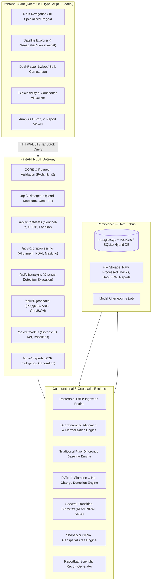

# GeoIntelligence AI — System Architecture Specification

## 1. Executive Architecture Summary
**GeoIntelligence AI** is an enterprise-grade Earth Observation (EO) intelligence platform engineered for multi-temporal satellite surface change detection, semantic land-cover transition analysis, rigorous geospatial area quantification, explainable AI (XAI), and automated research reporting.

The system enforces strict decoupling between:
1. **Satellite Ingestion & Quality Control** (Multi-band GeoTIFF, Sentinel-2 Level-2A, NoData handling)
2. **Geospatial Preprocessing Engine** (Reprojection, pixel-grid co-registration, reslicing, radiometric normalization)
3. **Dual-Model Change Detection Engine** (Traditional Computer Vision baseline + Deep Siamese U-Net + Experimental ChangeFormer)
4. **Spectral Land-Cover Transition Classifier** (NDVI, NDWI, NDBI spectral difference signatures)
5. **Rigorous Geospatial Engine** (Polygonization, noise suppression, equal-area projected CRS metric calculation)
6. **Explainable AI (XAI)** (Change heatmaps, difference magnitude, prediction confidence distributions)
7. **Client Presentation & GIS Layer** (React 19, TypeScript, Tailwind CSS, Leaflet)

---

## 2. Technical Architecture Diagram

---

## 3. Detailed Component Architecture

### A. Satellite Image Acquisition Module
- Handles multispectral GeoTIFF files (Sentinel-2 L2A 12 bands, Landsat 8/9, OSCD).
- Extracts geospatial metadata: Coordinate Reference System (CRS via EPSG code / WKT), affine geotransform, pixel dimensions, bounding coordinates (WGS84 lat/long and projected), radiometric data types, and nodata masks.
- Extracts RGB natural color (B04, B03, B02) and false-color infrared composites (B08, B04, B03).

### B. Preprocessing Engine
- **Spatial Alignment**: Reprojects non-conforming rasters to a common target CRS using nearest/bilinear interpolation via Rasterio/GDAL transforms.
- **Resampling**: Standardizes spatial resolutions (e.g. 10m/pixel).
- **Radiometric Normalization**: Percentile clipping (2nd - 98th percentile) and min-max normalization to standard floating-point tensors $[0, 1]$.
- **Cloud & Shadow Filtering**: Evaluates scene validity and warns on excessive invalid or obscured pixels.

### C. Change Detection Engine
- **Model 1 (Baseline)**: Absolute pixel difference with adaptive Otsu / percentile thresholding, morphological noise removal (opening and closing), and connected component filtering.
- **Model 2 (Deep Learning)**: Siamese U-Net. Dual-encoder weight-sharing backbone extracts deep hierarchical features ($F_{t1}, F_{t2}$) from both temporal acquisitions. Feature distance / concatenation fed to decoder to yield calibrated change probability maps $P(\text{change} \mid x, y)$.
- **Model 3 (Experimental)**: ChangeFormer transformer architecture for multi-scale attention-based change extraction.

### D. Spectral Land-Cover Transition Classifier
Calculates verified remote sensing spectral indices:
- **NDVI** (Normalized Difference Vegetation Index): $(B08 - B04) / (B08 + B04)$
- **NDWI** (Normalized Difference Water Index): $(B03 - B08) / (B03 + B08)$
- **NDBI** (Normalized Difference Built-up Index): $(B11 - B08) / (B11 + B08)$

Transitions are classified scientifically into:
1. **Deforestation / Vegetation Loss**: Significant decrease in NDVI ($\Delta \text{NDVI} < -\tau_v$) in changed zones.
2. **Flooding / Water Inundation**: Significant increase in NDWI ($\Delta \text{NDWI} > \tau_w$) in changed zones.
3. **Urban Expansion / Construction**: Increase in NDBI ($\Delta \text{NDBI} > \tau_b$) with concomitant vegetation decrease.
4. **Agricultural Modification**: Seasonal or crop turnover variations.
5. **Unclassified Change**: High-confidence change without clear single spectral class domination.

### E. Geospatial Analysis Engine
- Converts binary raster change masks into vector polygon geometries using `rasterio.features.shapes` and `shapely.geometry.shape`.
- Filters out polygon noise below configurable minimum mapping unit thresholds (e.g. $< 100 \text{ m}^2$).
- **Crucial Scientific Rule**: Area calculation is never performed on raw lat/long degrees. Geometries are reprojected to equal-area projection or appropriate local UTM zones via `pyproj.Transformer` / `shapely.ops.transform` to yield exact real-world metric areas in:
  - Hectares ($1 \text{ ha} = 10,000 \text{ m}^2$)
  - Square Kilometers ($\text{km}^2$)
  - Square Meters ($\text{m}^2$)
- Generates standard RFC 7946 GeoJSON FeatureCollections annotated with category, area, and confidence attributes.

### F. Explainable AI & Quality Assurance
- Outputs pixel-wise change probability heatmaps $[0.0, 1.0]$.
- Categorizes prediction confidence into distinct research tiers: High Confidence ($> 0.85$), Moderate Confidence ($0.65 - 0.85$), Low Confidence / Ambiguous ($0.50 - 0.65$).
- Distinguishes model confidence from spatial geometric precision.

### G. Database Architecture
Dual-tier database engine:
- **PostgreSQL 18 + PostGIS**: Enterprise spatial database with indexing and geometry support.
- **SQLite Engine**: Zero-configuration local database storing GeoJSON geometry strings, enabling instantaneous local running and testing.
